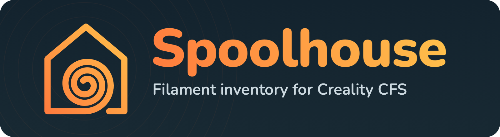

<p align="center">
  
</p>

<p align="center">
  <a href="https://spoolhouse.app">spoolhouse.app</a> ·
  <a href="https://github.com/rizdem/spoolhouse/releases/latest">Download for Mac</a>
</p>

<p align="center">
  <a href="https://buymeacoffee.com/rizdem"></a>
</p>

A free app for Mac (Apple Silicon and Intel) and Windows that keeps track of every spool of filament you own: what's left, what it cost, what's
loaded in your printer and what each print used. It writes and reads the RFID tags for Creality's CFS
filament system (K2 / K1 / Hi) with a cheap USB NFC reader. No account, no cloud.

*Previously called CFS Tag Writer.*

> Not affiliated with or endorsed by Creality. "Creality", "CFS" and product names belong
> to their owners.

## Features

**Create tags**
- Write both tags for a spool: pick the material, colour and weight.
- Read and wipe tags. Wiped tags are blank and reusable.
- Every spool gets a unique serial, checked against everything the app has issued before.

**Inventory**
- Scan a spool to add it, or to update how much is left.
- Weigh a spool on a kitchen scale and the app works out what's left.
- Totals: spools in stock (as spool equivalents, e.g. 5.5), kg left, value left, total spent.
- Running-low alerts per material and colour, with a threshold you set.
- Search, and filter by type, brand, colour family and shop. The totals follow your filters.
- Every spool is scanned in, so usage tracking stays accurate. A By filament view and multi-select delete.
- Shopping list from what's running low, with last price and shop, ready to copy or email.
- Deleted spools can be undone, and stay in Recently deleted for 30 days.

**Printers** (Creality K-series on your network, tested on a K2 Pro)
- Add as many printers as you have, each with a name and model.
- See what's in each CFS slot and how much is left, live.
- Slots link to your spools automatically from their tags. Filament the printer uses comes off your stock automatically.
- Print log: each job's filament use in metres and grams, and which spools it came from.
- Will it fit?: checks a print needs no more of each colour than its spool has left, before and during printing.
- Mac notifications: print finished, filament running out, low stock, prints to charge, CFS humidity, reader.
- Read-only: the app never sends commands to the printer.

**Runs in the background**
- Closing the window keeps the app in the menu bar (Mac) or system tray (Windows), so printer usage is still tracked. Optionally starts when you log in.
- Tells you when a new version is out (checks GitHub once a day; can be switched off).

**Phone app** (Android)
- Pair the Spoolhouse phone app in Settings → Phone access to see your inventory and printers on your phone,
  over your home Wi-Fi (encrypted; only paired phones can connect).

**Your data**
- Cost per print and a monthly total.
- Automatic backups to a NAS or any folder, one-click backup and restore, and CSV export.

Your data stays on your computer: `~/Library/Application Support/Spoolhouse/inventory.db` on a Mac,
`%APPDATA%\Spoolhouse\inventory.db` on Windows.
Upgrading from CFS Tag Writer copies your data over automatically and keeps the old folder as a backup.

## What you need

- Windows 10 or 11 (64-bit), a Mac with Apple Silicon (M1 or later) running macOS 11 or later, or an Intel Mac
  running macOS 10.15 Catalina or later.
- A PC/SC USB NFC reader for MIFARE Classic tags. Tested with the **ACS ACR122U**.
- MIFARE Classic 1K tags or stickers.
- Quit anything else using the reader first (e.g. SimplyPrint NFC Agent).
- On Windows the ACR122U is usually set up automatically; if it isn't found, install ACS's driver from acs.com.hk.

## Install

**Windows:** download `Spoolhouse-<version>-windows-setup.exe` from **Releases** and run it (no administrator
needed). If SmartScreen says it protected your PC, click **More info → Run anyway**.

**Mac:**

1. Download from **Releases** and unzip it: `Spoolhouse-<version>-apple-silicon.zip` for M1 and later,
   or `Spoolhouse-<version>-intel.zip` for Intel Macs. (Apple menu → About This Mac shows which you have.)
2. Drag **Spoolhouse** into **Applications**.
3. **First launch:** the app isn't notarized by Apple, so macOS will block it the first time.
   Open **System Settings → Privacy & Security**, scroll down and click **Open Anyway**,
   then confirm. You only need to do this once.

## Build from source

```bash
uv venv --python 3.12 --python-preference only-managed .venv
uv pip install --python .venv/bin/python -r requirements-dev.txt
./build_app.sh          # runs the tests, then builds dist/Spoolhouse.app and a release zip
./build_app.sh intel    # the Intel version (setup steps are at the top of build_app.sh)
```

On Windows (needs [Inno Setup 6](https://jrsoftware.org/isdl.php) for the installer):

```bat
uv venv --python 3.12 --python-preference only-managed .venv
uv pip install --python .venv\Scripts\python.exe -r requirements-dev.txt
.venv\Scripts\python.exe build_windows.py   :: tests, app, self-test, then dist\Spoolhouse-<version>-windows-setup.exe
```

**Releases are built by GitHub:** push a version tag (`git tag v2.4.0 && git push origin v2.4.0`) and the
Build workflow makes all three downloads, self-tests them, and attaches them to a draft release.

Run without building:

```bash
.venv/bin/python cfs_app.py      # native window
.venv/bin/python cfs_gui.py      # same UI in your browser
.venv/bin/python cfs_tag.py read # command line
```

## Project layout

| Path | What it is |
|---|---|
| `cfs_app.py` | The desktop app: window, file dialogs, start-up (`--self-test` checks a build) |
| `app_core.py` | Shared by Mac and Windows: log file, status lines for the menu bar / tray |
| `app_mac.py`, `app_windows.py` | Menu bar or system tray, open at login / start with Windows, notifications |
| `cfs_gui.py` | The local server the app talks to (also runs on its own in a browser) |
| `web/` | The interface: `index.html`, `style.css` and `js/` (one file per area) |
| `cfs_tag.py` | Reading and writing CFS tags (also a command-line tool) |
| `inventory.py` | Spools, usage, costs, backups (SQLite) |
| `printer.py` | Talking to Creality printers on your network (read-only) |
| `tests/` | Automated tests: `.venv/bin/python -m pytest` |

## Troubleshooting

- **"The NFC reader stopped responding"**: unplug the reader and plug it back in.
- **No reader found**: check the USB connection and quit other NFC apps.
- Logs are written to `~/Library/Logs/Spoolhouse.log` (Mac) or `%LOCALAPPDATA%\Spoolhouse\Spoolhouse.log` (Windows).

## Credits

The CFS tag format and keys come from the reverse-engineering work in
[DnG-Crafts/K2-RFID](https://github.com/DnG-Crafts/K2-RFID). Thank you!

## Licence

Spoolhouse is free software under the [GNU General Public License v3.0](LICENSE): you can use, share and
change it, and anything built from it must stay open source under the same licence.

## Support

If this saves you time, you can buy me a beer:

<a href="https://buymeacoffee.com/rizdem"></a>
